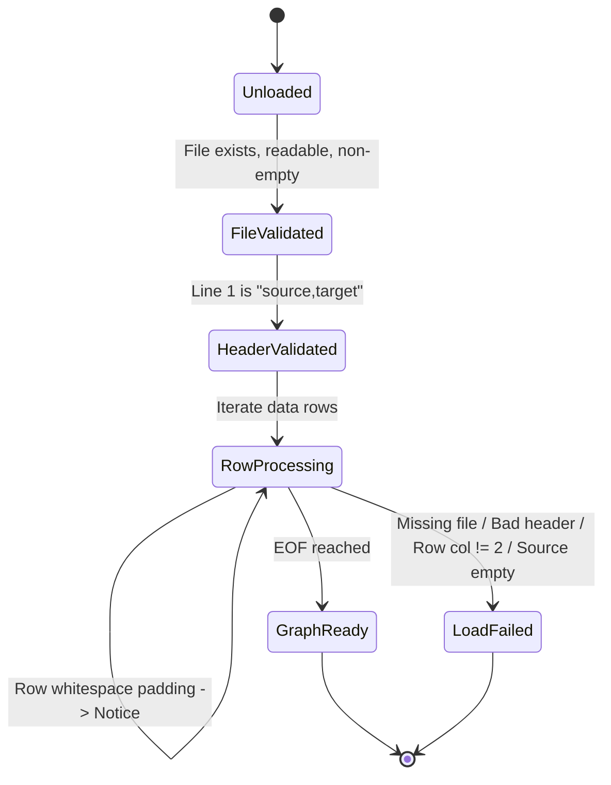

# Data Model: Directed Graphs (Loading & Display)

**Feature**: Directed Graphs (Loading & Display)  
**Branch**: `001-directed-graphs`  
**Date**: 2026-11-02  
**Status**: Ready for Implementation  

---

## 1. Entities & Data Types

### 1.1 `Vertex`
A vertex is an individual entity in the directed dependency graph.
- **Type**: `str`
- **Identity**: Case-sensitive string identifier (e.g. `"Data Structures"` is distinct from `"data structures"`).
- **Constraints**:
  - Must not be empty or whitespace-only.
  - Leading and trailing whitespace are stripped upon loading.
  - Internal whitespace (e.g. `"Data Structures"`) is preserved verbatim.

### 1.2 `DirectedEdge`
A directed relationship pointing from a prerequisite/dependency to a dependent.
- **Type**: `tuple[str, str]` (or `(source, target)`)
- **Fields**:
  - `source`: The originating vertex name (`str`).
  - `target`: The terminating vertex name (`str`).
- **Constraints**:
  - `source` and `target` must both be valid vertices present in the graph.
  - In an unweighted directed graph, an edge is uniquely identified by `(source, target)`.
  - Self-loops (`source == target`) are valid.

### 1.3 `DirectedGraph`
The in-memory directed graph data model.
- **Internal State**:
  - `_adj: dict[str, set[str]]`: Maps each vertex to its set of outgoing successor vertices.
  - `_pred: dict[str, set[str]]`: Maps each vertex to its set of incoming predecessor vertices.
- **Class Invariants**:
  - Consistency: For every vertex $v$, $v \in \text{keys}(\text{\_adj})$ and $v \in \text{keys}(\text{\_pred})$.
  - Reciprocity: $(u, v) \in \text{Edges} \iff v \in \text{\_adj}[u] \iff u \in \text{\_pred}[v]$.
  - Degree Invariant: `in_degree(v) == len(_pred[v])` and `out_degree(v) == len(_adj[v])`.
  - Set Semantics: No duplicate edges exist in `_adj[u]`.
- **Public Interface**:
  - `add_vertex(vertex: str) -> bool`: Inserts `vertex` if not present. Returns `True` if new, `False` if already existed.
  - `add_edge(source: str, target: str) -> bool`: Inserts directed edge `(source, target)`, adding vertices if needed. Returns `True` if new edge, `False` if duplicate.
  - `has_vertex(vertex: str) -> bool`: Checks whether vertex exists in $O(1)$.
  - `has_edge(source: str, target: str) -> bool`: Checks whether edge exists in $O(1)$.
  - `vertices() -> set[str]`: Returns a set of all vertex names in the graph.
  - `edges() -> set[tuple[str, str]]`: Returns a set of all directed edge pairs `(source, target)`.
  - `successors(vertex: str) -> set[str]`: Returns outgoing neighbors for `vertex`. Raises `KeyError` if vertex does not exist.
  - `predecessors(vertex: str) -> set[str]`: Returns incoming neighbors for `vertex`. Raises `KeyError` if vertex does not exist.
  - `in_degree(vertex: str) -> int`: Returns in-degree of `vertex`. Raises `KeyError` if vertex does not exist.
  - `out_degree(vertex: str) -> int`: Returns out-degree of `vertex`. Raises `KeyError` if vertex does not exist.
  - `order() -> int`: Returns total number of vertices $|V|$.
  - `size() -> int`: Returns total number of unique directed edges $|E|$.

### 1.4 `DiagnosticLevel`
Classification of non-fatal irregularities observed during loading.
- **Type**: `enum.Enum` or `Literal["NOTICE", "WARNING"]`
  - `NOTICE`: Informational adjustments (isolated vertex declaration, whitespace trimming).
  - `WARNING`: Redundant data detected (duplicate edge encountered and ignored).

### 1.5 `Diagnostic`
Encapsulates a single non-fatal observation made during parsing.
- **Type**: Dataclass
- **Attributes**:
  - `line_num: int`: 1-based physical line number in the input CSV file.
  - `level: DiagnosticLevel`: Severity level.
  - `message: str`: Human-readable description of the action taken.

### 1.6 `LoadResult`
The container returned by the loader upon successful completion.
- **Type**: Dataclass
- **Attributes**:
  - `graph: DirectedGraph`: The constructed directed graph instance.
  - `diagnostics: list[Diagnostic]`: Ordered list of all non-fatal diagnostics collected, preserved in file encounter order.

### 1.7 `GraphLoadError`
Custom exception class raised when encountering fatal input anomalies.
- **Inherits**: `Exception`
- **Attributes**:
  - `message: str`: Clear, actionable explanation of the failure.
  - `line_num: int | None`: Physical line number where failure occurred, if applicable.

---

## 2. Invariants & Validation Rules

1. **Header Row**:
   - Must be the first non-empty line of the file.
   - Must match exact token sequence `["source", "target"]`.
   - Any variation (e.g. `source, target`, `from,to`, `Source,Target`) is a fatal validation error.
2. **Column Count**:
   - Every data row must yield exactly 2 elements when parsed by `csv.reader`.
   - Rows with 1 or $\ge 3$ columns trigger a fatal `GraphLoadError` with line number.
3. **Source Vertex Validation**:
   - `source` after trimming must not be empty.
   - An empty source (e.g. `,target` or `  ,target`) triggers a fatal `GraphLoadError`.
4. **Target Vertex Semantics**:
   - Non-empty string: Standard edge $(u, v)$ added.
   - Empty string (e.g. `watch,`): Isolated vertex $u$ added to `_adj[u]` with $\emptyset$ successors and predecessors.
5. **Deduplication**:
   - Duplicate edges $(u, v)$ do not produce multiple entries in `_adj[u]`.
   - The first occurrence inserts the edge; subsequent occurrences append a `WARNING` diagnostic to `diagnostics`.
6. **Cycle & Self-Loop Permissiveness**:
   - A self-loop $(u, u)$ adds $u \in \text{\_adj}[u]$ and $u \in \text{\_pred}[u]$.
   - Cycles $(u \to v \to u)$ are accepted as normal directed edges.
