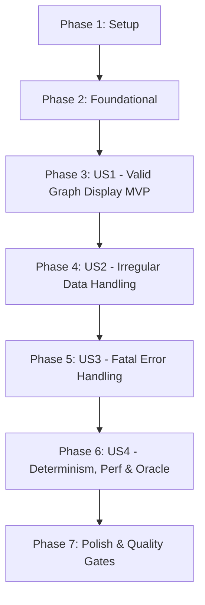

# Tasks: Directed Graphs (Loading & Display)

**Input**: Design documents from `specs/001-directed-graphs/` (`spec.md`, `plan.md`, `research.md`, `data-model.md`, `contracts/cli.md`, `quickstart.md`)  
**Prerequisites**: Python 3.11+, pytest, ruff, networkx (tests only)  
**Organization**: Tasks are strictly grouped by user story to enable test-first, independent implementation and verification of each story.

## Format: `[ID] [P?] [Story] Description`

- **[P]**: Can run in parallel (different files, no dependencies)
- **[Story]**: Which user story this task belongs to (e.g., US1, US2, US3, US4)
- Exact file paths are included in every task description

---

## Phase 1: Setup (Shared Infrastructure)

**Purpose**: Project initialization, directory structure, and development environment configuration.

- [ ] T001 Create project package directory structure per implementation plan: `src/__init__.py`, `tests/__init__.py`, `tests/unit/__init__.py`, `tests/integration/__init__.py`, `tests/oracle/__init__.py`, and `tests/data/`
- [ ] T002 [P] Create `pyproject.toml` with Python 3.11+ requirement, dev dependencies (`pytest`, `ruff`, `networkx`), ruff linter/formatter rules, and pytest test discovery paths
- [ ] T003 [P] Create pytest configuration and shared fixtures in `tests/conftest.py` providing paths to `data/` and `tests/data/` fixtures

---

## Phase 2: Foundational (Blocking Prerequisites)

**Purpose**: Core data structures and exception types that MUST be complete before ANY user story can be implemented.

**⚠️ CRITICAL**: No user story work can begin until this phase is complete.

- [ ] T004 Write unit tests for `DirectedGraph` in `tests/unit/test_graph.py` asserting `add_vertex(v)`, `add_edge(u, v)`, `vertices()`, `edges()`, `successors(v)`, `predecessors(v)`, `in_degree(v)`, `out_degree(v)`, `has_vertex(v)`, `has_edge(u, v)`, self-loops `(u, u)`, and cycles (observe failing)
- [ ] T005 Implement `DirectedGraph` data model in `src/graph.py` with private `_adj: dict[str, set[str]]` and `_pred: dict[str, set[str]]`, zero I/O, ensuring invariants: `in_degree(v) == len(_pred[v])`, `out_degree(v) == len(_adj[v])`, and $O(1)$ duplicate edge rejection
- [ ] T006 [P] Define data classes and exception types in `src/loader.py`: `DiagnosticLevel = Literal["NOTICE", "WARNING"]`, `Diagnostic(line_num: int, level: DiagnosticLevel, message: str)`, `LoadResult(graph: DirectedGraph, diagnostics: list[Diagnostic])`, and `GraphLoadError(Exception)` with `message: str` and optional `line_num: int | None`

**Checkpoint**: Foundation ready — `DirectedGraph` model and base types tested and verified; User Story 1 can begin.

---

## Phase 3: User Story 1 - Load and Display Valid Directed Graph (Priority: P1) 🎯 MVP

**Goal**: Load a valid CSV file containing directed edges and display its vertices and edges on stdout with element counts and deterministic lexicographical sorting.

**Independent Test**: Execute CLI against `data/small-dag.csv` and header-only fixture; verify stdout outputs `Vertices (<V>):` and `Edges (<E>):` indented by 2 spaces, sorted lexicographically, exiting with status 0.

### Tests for User Story 1 (Test-First: Write FIRST, observe FAILING) ⚠️

- [ ] T007 [P] [US1] Create test fixture `tests/data/header_only.csv` containing exactly the header line `"source,target"` and zero data rows
- [ ] T008 [P] [US1] Write unit tests in `tests/unit/test_loader.py` for valid graph loading: header validation matching `"source,target"`, standard edge parsing, and empty header-only file returning empty graph (`order() == 0`, `size() == 0`)
- [ ] T009 [P] [US1] Write integration subprocess tests in `tests/integration/test_cli.py` for US1 acceptance scenarios 1.1, 1.2, and 1.3: execute CLI via subprocess against `data/small-dag.csv`, `data/build-with-cycle.csv`, and `tests/data/header_only.csv`, asserting exit code 0, 2-space indentation, and lexicographical ordering

### Implementation for User Story 1

- [ ] T010 [US1] Implement valid CSV parsing in `src/loader.py`: open with `utf-8-sig`, validate header is exactly `["source", "target"]`, parse 2-column data rows, insert into `DirectedGraph`, and return `LoadResult(graph, diagnostics=[])`
- [ ] T011 [US1] Implement CLI entry point and display formatting in `src/cli.py` using `argparse`: support `python3 -m src.cli [display] <file.csv>`, format stdout as `Vertices (<count>):` and `Edges (<count>):` with 2-space indent and lexicographical sorting, and exit 0

**Checkpoint**: User Story 1 (MVP) is fully functional and independently testable via `pytest tests/unit/test_loader.py tests/integration/test_cli.py -k US1`.

---

## Phase 4: User Story 2 - Irregular Data Handling with Transparent Reporting (Priority: P2)

**Goal**: Handle input irregularities (whitespace padding around vertex names, duplicate edges, empty target fields) by normalizing/deduplicating and reporting line-numbered notices and warnings to stderr, without silent alteration.

**Independent Test**: Execute CLI against `data/cs-curriculum.csv` and inputs with padded whitespace; verify warnings on stderr and deduplicated/normalized output on stdout with exit code 0.

### Tests for User Story 2 (Test-First: Write FIRST, observe FAILING) ⚠️

- [ ] T012 [P] [US2] Create test fixtures `tests/data/padded_whitespace.csv` (rows with `" pants ", " shoes "`) and `tests/data/duplicate_edges.csv` (repeated edges)
- [ ] T013 [P] [US2] Write unit tests in `tests/unit/test_loader.py` for US2: whitespace trimming generating `Diagnostic(level="NOTICE", message="Line {line}: normalized vertex '{raw}' -> '{trimmed}'")`, duplicate edge detection generating `Diagnostic(level="WARNING", message="Line {line}: duplicate edge '{source} -> {target}' ignored")`, and empty target generating `Diagnostic(level="NOTICE", message="Line {line}: added isolated vertex '{source}'")`
- [ ] T014 [P] [US2] Write integration subprocess tests in `tests/integration/test_cli.py` for US2 acceptance scenarios 2.1, 2.2, and 2.3: execute CLI against `data/cs-curriculum.csv` (duplicate edge on line 25), `tests/data/padded_whitespace.csv`, and `data/small-dag.csv` (isolated vertex on line 11), asserting stderr output and exit code 0

### Implementation for User Story 2

- [ ] T015 [US2] Implement whitespace trimming, duplicate edge tracking, and isolated vertex handling in `src/loader.py`: record line-numbered `Diagnostic` entries in encounter order within `LoadResult` without printing
- [ ] T016 [US2] Update `src/cli.py` to iterate through `LoadResult.diagnostics` and write each formatted message to `sys.stderr` before printing graph output to `stdout`

**Checkpoint**: User Stories 1 and 2 are fully functional and pass all unit and integration tests.

---

## Phase 5: User Story 3 - Actionable Error Feedback on Fatal Input Failures (Priority: P3)

**Goal**: Terminate immediately with non-zero exit status (1) and actionable error messages on stderr when encountering unrecoverable input errors (missing file, empty file, invalid header, malformed row columns, empty source).

**Independent Test**: Execute CLI against non-existent file, 0-byte file, bad header, and malformed rows; verify exit status 1, clear `Error: ...` message on stderr, empty stdout, and no traceback.

### Tests for User Story 3 (Test-First: Write FIRST, observe FAILING) ⚠️

- [ ] T017 [P] [US3] Create invalid test fixtures: `tests/data/empty_file.csv` (0 bytes), `tests/data/invalid_header.csv` (`from,to`), `tests/data/wrong_columns.csv` (row with 3 columns `a,b,c`), and `tests/data/empty_source.csv` (row with `,target`)
- [ ] T018 [P] [US3] Write unit tests in `tests/unit/test_loader.py` asserting `GraphLoadError` is raised for non-existent paths, directories, empty files, invalid headers, wrong column counts, and empty source vertex values
- [ ] T019 [P] [US3] Write integration subprocess tests in `tests/integration/test_cli.py` for US3 acceptance scenarios 3.1–3.4: asserting exit code 1, stderr starting with `Error: `, empty stdout, and zero unhandled tracebacks; also assert exit code 2 for CLI usage errors

### Implementation for User Story 3

- [ ] T020 [US3] Implement fatal validation checks in `src/loader.py`: raise `GraphLoadError` on missing file, directory path, 0-byte empty file, header not matching `["source", "target"]`, column count `!= 2`, and empty source vertex after trimming
- [ ] T021 [US3] Implement exception handling in `src/cli.py`: catch `GraphLoadError`, write `Error: {message}` to `sys.stderr`, and exit with code 1 without printing a stack trace

**Checkpoint**: User Stories 1, 2, and 3 are fully functional; all fatal error cases terminate gracefully with exit code 1.

---

## Phase 6: User Story 4 - Deterministic and Testable Output (Priority: P4)

**Goal**: Guarantee byte-for-byte identical output on repeated runs, achieve sub-second performance on 10,000 edges, and verify graph model correctness against NetworkX oracle.

**Independent Test**: Run determinism test, performance benchmark test, and NetworkX oracle validation test.

### Tests for User Story 4 (Test-First: Write FIRST, observe FAILING) ⚠️

- [ ] T022 [P] [US4] Implement determinism integration tests in `tests/integration/test_cli.py` asserting byte-for-byte equality of stdout and stderr across repeated runs of `data/cs-curriculum.csv` and `data/build-with-cycle.csv`
- [ ] T023 [P] [US4] Implement performance benchmark test in `tests/integration/test_performance.py` generating a synthetic graph with 10,000 edges and asserting load and display completes under 1.0 second (SC-001)
- [ ] T024 [P] [US4] Implement oracle verification tests in `tests/oracle/test_networkx_oracle.py` using `networkx.DiGraph` to cross-check vertex sets and edge sets loaded from `data/*.csv` against NetworkX

### Implementation for User Story 4

- [ ] T025 [US4] Review and optimize sorting and collection in `src/cli.py` and `src/loader.py` to ensure strict deterministic ordering and sub-second execution for graphs with 10,000 edges

**Checkpoint**: All 4 user stories functional; determinism, performance, and oracle cross-checks pass.

---

## Phase 7: Polish & Cross-Cutting Concerns

**Purpose**: Quality gates, static analysis, formatting, and end-to-end documentation validation.

- [ ] T026 [P] Run static analysis and formatting checks using `ruff check .` and `ruff format --check .`, fixing any warnings or formatting errors
- [ ] T027 [P] Execute full test suite (`pytest -v`) and validate all manual scenarios in `specs/001-directed-graphs/quickstart.md`
- [ ] T028 [P] Verify documentation links and reflection questions alignment in `specs/001-directed-graphs/`

---

## Dependencies & Execution Order

### Phase Dependencies

- **Setup (Phase 1)**: No dependencies — can start immediately.
- **Foundational (Phase 2)**: Depends on Phase 1 — BLOCKS all user stories.
- **User Stories (Phase 3 → 6)**: Implemented sequentially by priority (P1 🎯 MVP → P2 → P3 → P4). Within each story phase, tests are written and observed failing before implementation.
- **Polish (Phase 7)**: Depends on all user stories passing.

---

## Parallel Execution Opportunities

- **Phase 1**: `T002` (pyproject.toml) and `T003` (conftest.py) can run in parallel.
- **Phase 2**: `T006` (loader data classes) can run in parallel with `T004`/`T005` (DirectedGraph model).
- **Phase 3**: Test fixtures and tests `T007`, `T008`, `T009` can be written in parallel.
- **Phase 4**: Test fixtures and tests `T012`, `T013`, `T014` can be written in parallel.
- **Phase 5**: Fixtures and tests `T017`, `T018`, `T019` can be written in parallel.
- **Phase 6**: `T022`, `T023`, `T024` can be written in parallel.
- **Phase 7**: `T026`, `T027`, `T028` can run in parallel.

---

## Implementation Strategy (MVP First)

1. **Step 1**: Complete Phase 1 (Setup) and Phase 2 (Foundational: `DirectedGraph` model and base types).
2. **Step 2**: Implement Phase 3 (User Story 1: Valid CSV load & display). **Validate MVP independently** using `small-dag.csv` and header-only fixture.
3. **Step 3**: Incrementally add User Story 2 (Irregularities: duplicates, whitespace, empty targets). Validate against `cs-curriculum.csv`.
4. **Step 4**: Add User Story 3 (Fatal error diagnostics & exit code 1).
5. **Step 5**: Add User Story 4 (Determinism, performance benchmark, and NetworkX oracle validation).
6. **Step 6**: Execute Phase 7 (Ruff check, formatting, full test suite pass).
